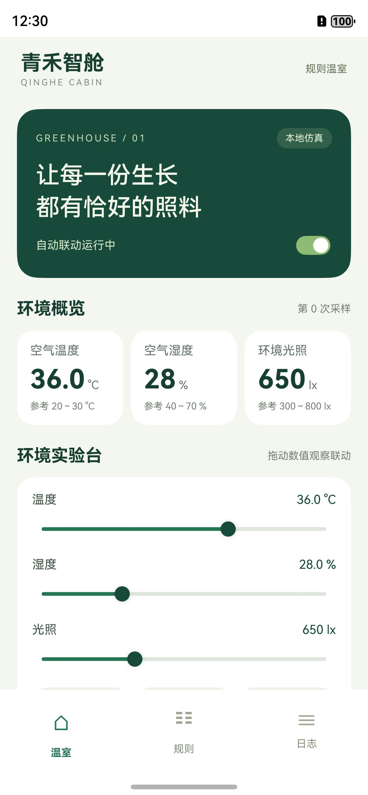
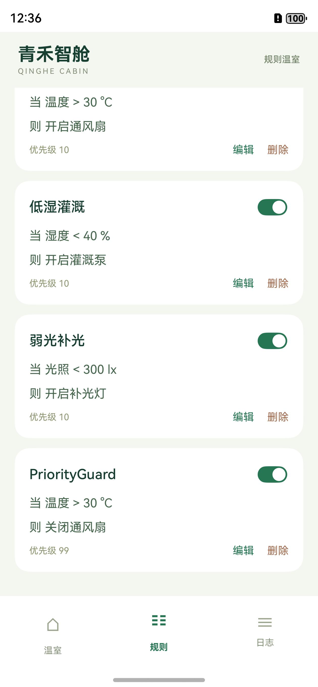
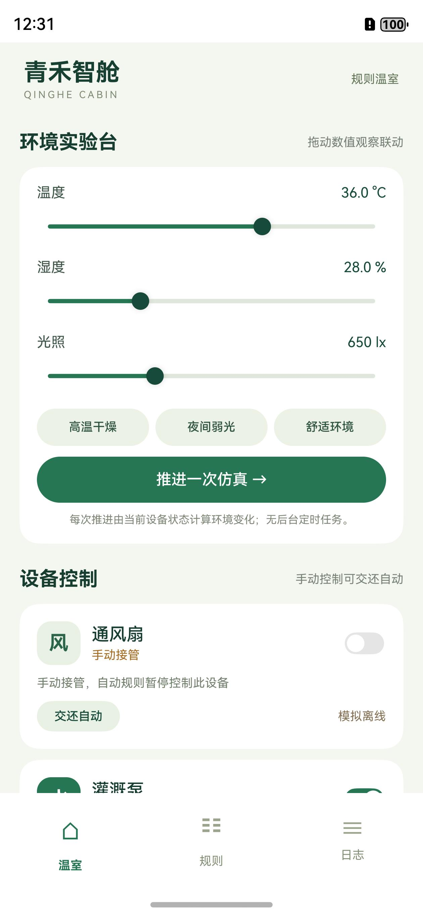
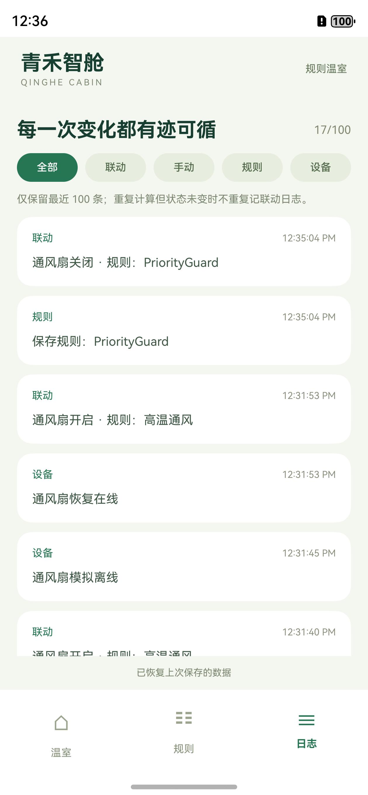

# 青禾智舱

HarmonyOS 智能温室规则仿真应用，课程《移动应用开发基础》期末项目，对应主题三。

维护者：张赟，24物联1班。GitHub：sbz1121y-cell。初始代码使用 AI 辅助生成，个人实际开发贡献以本人审阅、修改、调试和 GitHub 提交记录为准。

## 当前验证情况

- 已通过 HarmonyOS API17 的 ArkTS 编译，生成未签名的 HAP。
- 24/24 项纯业务源码测试通过，详见 [测试证据](docs/evidence/unit-tests.json)。
- 已在 Huawei_Phone API17 模拟器安装运行，14/14 项集成检查通过，详见 [模拟器检查](docs/evidence/device-tests.json)。
- 已验证高温联动、手动接管、离线恢复、自定义规则优先级与强制停止后的数据恢复。
- 本次模拟器允许安装未签名 HAP；普通真机请通过 DevEco Studio 自动签名后运行。

## 功能

温度、湿度与光照模拟；高温干燥、夜间弱光和舒适环境预设；规则增删改与启停；优先级冲突处理；风扇、灌溉泵、补光灯控制；手动接管与交还自动；离线拦截；单步仿真与最近采样；事件筛选；Preferences 持久化与损坏存档校验。

## 开发环境与运行方法

1. 使用 DevEco Studio 5.0.13.240，HarmonyOS 5.0.5 API17。JBR17、Node18.20.1、Hvigor5.17.6 为已验证构建工具。
2. 下载本仓库，解压到英文路径，例如 `D:\HarmonyProjects\QingHeCabin`。路径中不要含中文。
3. 用 DevEco Studio 的 Open 打开包含 `build-profile.json5` 的工程根目录，等待 Sync 完成。
4. 首次打开在 SDK Manager 确认 API17 已安装；本地 SDK 路径由 IDE 自动生成，不在仓库中保存。
5. 在 Device Manager 启动 API17 或更新版本的手机模拟器；也可连接可开发的 HarmonyOS 真机。
6. 在项目签名设置中使用本人华为开发者账号完成自动签名。不要公开签名证书或私钥。
7. 选择 `entry` 和目标设备后点击 Run。实际运行需要系统虚拟化环境可用或连接真机。

纯业务测试：将 `DEVECO_HOME` 环境变量设为本机 DevEco Studio 安装根目录，然后运行 `node tests/run-tests.cjs`。也可用 `TYPESCRIPT_PATH` 指定 TypeScript 模块。测试会重写 `docs/evidence/unit-tests.json`，其中保存源码SHA256，便于核验。

## 页面与运行展示

以下均为真实模拟器截图。完整过程见 [操作录屏 demo.mp4](docs/evidence/demo.mp4)（约6分10秒，真实屏幕每约3秒采集一帧，保留原时间顺序，无配音）。具体步骤见 [运行验收记录](docs/acceptance.md)。

|温室面板|规则与优先级|
|---|---|
|||

|手动接管|执行日志|
|---|---|
|||

重启恢复原始证据：[停止前存档](docs/evidence/preferences-before.xml)、[启动后存档](docs/evidence/preferences-after.xml)、[恢复后页面](docs/evidence/10-after-restart.jpeg)。实际状态为32.4°C、37%、590lx，4条规则、3次采样，7个业务字段逐项对比一致。

## 模块

|目录|职责|
|---|---|
|entry/src/main/ets/pages|环境与设备界面、规则编辑、日志筛选、页面导航|
|entry/src/main/ets/components|MetricTile 自定义指标组件|
|entry/src/main/ets/model|环境、设备、规则、日志和快照模型|
|entry/src/main/ets/engine|条件判断、优先级、设备状态与仿真计算|
|entry/src/main/ets/storage|存档校验、Preferences读取、串行写入与flush|
|tests|直接加载实际业务源码的Mock测试|

完整接口、数据流和边界规则见 [需求说明书](docs/requirements.md)。

## 业务约定

条件使用严格 `>` 或 `<`，等于阈值不命中。同设备规则以更大的优先级数字为先，相同优先级按ID升序；没有命中时自动设备关闭。手动操作进入接管状态，点击“交还自动”后恢复计算。离线设备关闭并拒绝控制。全局暂停自动时设备保留当前状态。

本项目的环境和设备均为 Mock，不连接真实温室，不用作真实设备控制或种植指导。仿真仅在点击推进时进行。
